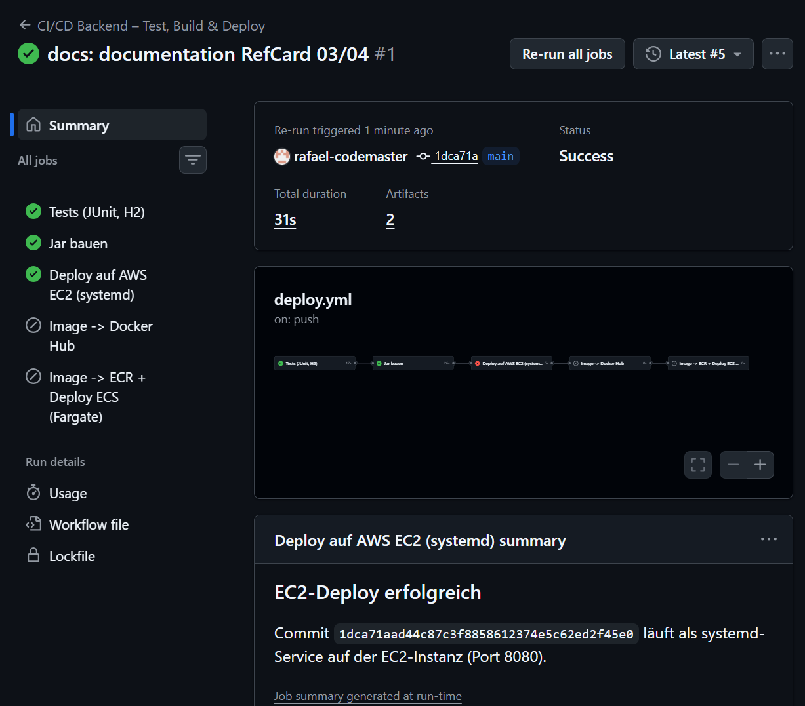
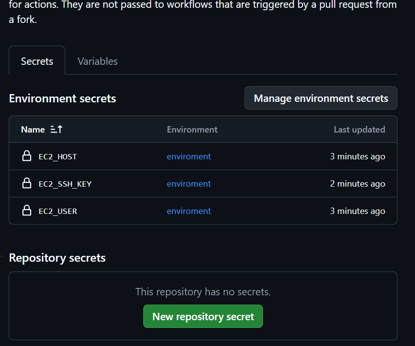
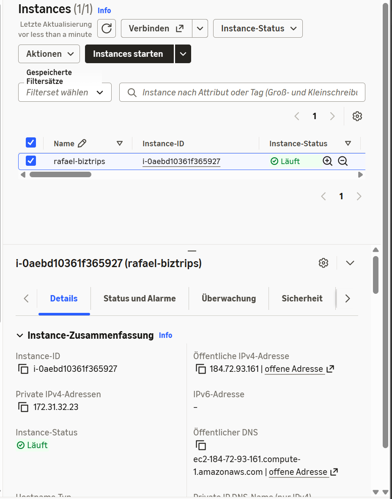

# EX-01 – Deploy des Spring-Boot-Backends (mit MariaDB) auf AWS EC2

**Ziel:** Jeder Push auf `main` testet und baut das Backend und spielt die `.jar` automatisch auf eine EC2-Instanz aus, auf der MariaDB läuft.

**Dateien:** [`.github/workflows/deploy.yml`](../../.github/workflows/deploy.yml) (Jobs `test`, `build`, `deploy`), [`scripts/ec2-setup.sh`](../../scripts/ec2-setup.sh)

## Vorgehen

1. **Repo verbinden:** Starter-Projekt (`v1-start`) übernommen, Remote auf `https://github.com/rafael-codemaster/refcard03.git` gesetzt, `git push -u origin main`.
2. **EC2-Instanz starten** (Learner Lab, Amazon Linux, Key `vockey`/`labsuser.pem`). Security Group: Port 22 und **8080** (Custom TCP, `0.0.0.0/0`) eingehend.
3. **Instanz vorbereiten:** per *EC2 Instance Connect* verbinden, Skript hochladen und ausführen:
   ```bash
   bash ec2-setup.sh
   ```
   Das Skript installiert Java 21, rsync und MariaDB, legt die DB `db_biztrips` mit eigenem DB-User (zufälliges Passwort, nur in `/etc/businesstrips.env`) an, erstellt `/opt/businesstrips` und den systemd-Service `businesstrips.service`.
4. **Environment `production`** angelegt (*Settings → Environments*) mit den Secrets `EC2_HOST`, `EC2_USER`, `EC2_SSH_KEY` (Inhalt von `labsuser.pem`).
5. **Repository-Variable** `DEPLOY_EC2 = true` gesetzt.
6. **Push auf `main`** → Workflow beobachten (*Actions*).
7. **Prüfen:**
   ```bash
   curl http://<EC2_HOST>:8080/actuator/health   # {"status":"UP",...}
   curl http://<EC2_HOST>:8080/v1/trips          # Demo-Trips als JSON
   ```

### Ablauf des `deploy`-Jobs

| Schritt | Was passiert |
|---|---|
| Artefakt laden | die in `build` erzeugte `.jar` |
| SSH-Key einrichten | prüft, dass alle 3 Secrets gesetzt sind und die Instanz erreichbar ist, sonst klare Fehlermeldung |
| rsync | `.jar` → `/opt/businesstrips/app.jar` |
| Neustart | schreibt `APP_VERSION=<commit>` und startet `businesstrips.service` neu |
| Health-Check | wartet, bis `/actuator/info` den neuen Commit zeigt und `/actuator/health` `UP` ist, sonst werden die Service-Logs ausgegeben |
| Key löschen | `if: always()` |

**Erweiterung „nur main“:** `deploy` (und damit `docker`) laufen nur bei `github.ref == 'refs/heads/main' && github.event_name != 'pull_request'`.

## Nachweise






## Reflexion

1. **Warum Environment-Secrets statt Repo-Secrets?** Sie sind nur für Jobs lesbar, die `environment: production` deklarieren. Am Environment lassen sich zusätzlich Schutzregeln (Reviewer, nur `main`) festlegen. Der SSH-Key liegt damit nicht offen für jeden Job im Repo.
2. **Warum braucht `build` keine Variable?** Spring Boot liest DB-URL, Profil usw. erst beim Start (hier aus `/etc/businesstrips.env`). Die `.jar` ist umgebungsneutral. Ein Vite-Build backt dagegen z. B. die API-URL fest ins JS-Bundle.
3. **Was wäre, wenn `deploy` auch bei PRs liefe?** Ungeprüfter Code (evtl. aus einem Fork) käme auf Produktion und hätte Zugriff auf den SSH-Key. Die Bedingung lässt nur echte Pushes auf `main` deployen.
4. **Warum `if: always()` beim Löschen des Keys?** Bricht ein Schritt vorher ab (z. B. rsync), würden die restlichen Schritte übersprungen und der Key bliebe auf dem Runner liegen. `always()` räumt in jedem Fall auf.
