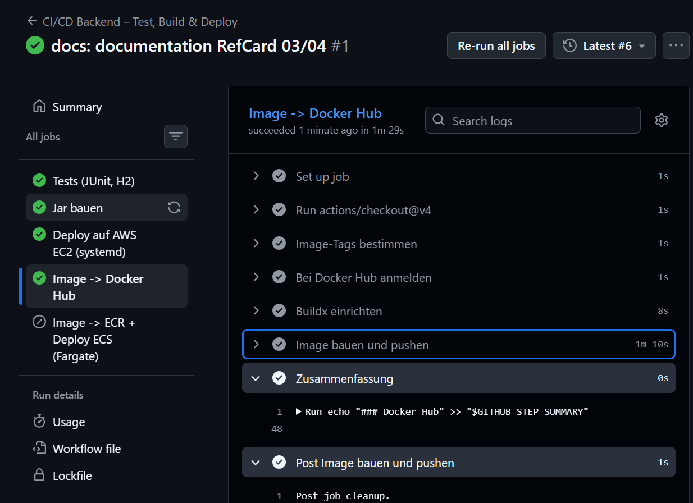
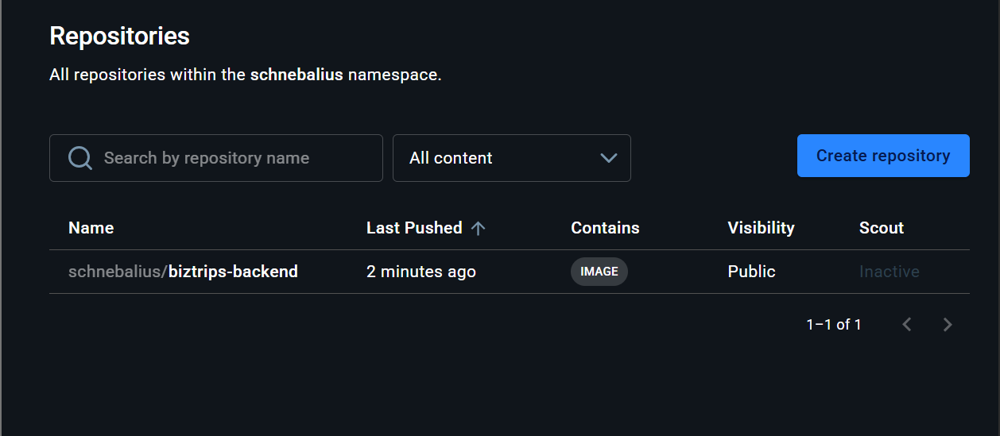

# EX-02 – Docker-Image bauen, taggen und auf Docker Hub veröffentlichen

**Ziel:** Das Backend als schlankes Docker-Image bauen, sinnvoll taggen und auf Docker Hub veröffentlichen, lokal und automatisiert über die Pipeline.

**Dateien:** [`Dockerfile`](../../Dockerfile), [`.dockerignore`](../../.dockerignore), [`docker/docker-compose.yml`](../../docker/docker-compose.yml), Job `docker` in [`deploy.yml`](../../.github/workflows/deploy.yml)

## Dockerfile (Multi-Stage)

| Stage | Basis | Inhalt |
|---|---|---|
| `build` | `eclipse-temurin:21-jdk` | Maven Wrapper, `dependency:go-offline` (eigener Layer → Cache), dann `package` |
| Runtime | `eclipse-temurin:21-jre-alpine` | nur JRE + `app.jar`, läuft als **Nicht-root-User** `app`, `HEALTHCHECK` auf `/actuator/health`, `VOLUME /app/uploads` (EX-04) |

## Vorgehen lokal

```bash
docker compose -f docker/docker-compose.yml up -d          # MariaDB + phpMyAdmin
export DOCKERHUB_USER=<mein-dockerhub-user>

docker build \
  -t "$DOCKERHUB_USER/biztrips-backend:prod01" \
  -t "$DOCKERHUB_USER/biztrips-backend:latest" \
  -t "$DOCKERHUB_USER/biztrips-backend:$(git rev-parse --short HEAD)" .

docker run --rm -p 8080:8080 --network docker_default \
  -e SPRING_PROFILES_ACTIVE=mariadb \
  -e SPRING_DATASOURCE_URL="jdbc:mariadb://bbw-mariadb-trips-dev:3306/db_biztrips" \
  "$DOCKERHUB_USER/biztrips-backend:prod01"
curl http://localhost:8080/v1/trips

docker login -u "$DOCKERHUB_USER"                           # mit Access Token
docker push --all-tags "$DOCKERHUB_USER/biztrips-backend"
```

Komfortabler: Backend + DB zusammen starten (DB-Healthcheck → Backend startet erst, wenn MariaDB bereit ist):

```bash
docker compose -f docker/docker-compose.yml --profile app up -d --build
```

## Automatisiert (Job `docker`)

- läuft nach erfolgreichem `deploy` und **nur auf `main`** (bzw. Release-Tags), nie bei Pull Requests
- Secrets `DOCKERHUB_USERNAME`, `DOCKERHUB_TOKEN`, Variable `PUSH_DOCKERHUB = true`
- Tags via `docker/metadata-action`: `prod01`, `latest`, kurzer + voller Commit-SHA, bei Git-Tag `v1.2.0` zusätzlich `1.2.0` und `1.2`
- BuildKit-Layer-Cache in GitHub Actions (`type=gha`)

## Nachweise

**Job „Image -> Docker Hub“ grün** (läuft nach dem EC2-Deploy, nur auf `main`):



**Image auf Docker Hub** im Namespace `schnebalius`:



## Reflexion

1. **Warum ist Stage 2 kleiner?** Das finale Image enthält nur JRE und `.jar`, kein JDK, kein Maven, keinen Quellcode und keinen Dependency-Cache. Das spart mehrere hundert MB und verkleinert die Angriffsfläche.
2. **Warum reicht `latest` nicht?** `latest` wandert bei jedem Build weiter. Später weiss niemand mehr, welcher Commit lief, und ein Rollback auf „das Vorherige“ ist unmöglich. Der SHA-Tag ist unveränderlich.
3. **Warum keine `ARG`s für die DB?** Spring liest die DB-Konfiguration zur Laufzeit aus Umgebungsvariablen. Dasselbe Image läuft unverändert gegen lokale MariaDB, Test- oder Produktions-DB (RDS). (`APP_VERSION` ist nur Metadaten für `/actuator/info`, keine Konfiguration.)
4. **EX-01 vs. Docker:** EX-01 braucht einen vorbereiteten Server (Java, MariaDB, systemd). Das Image bringt seine Runtime selbst mit und läuft überall gleich, lokal wie auf ECS. Nachteile: zusätzliche Registry, Image-Grösse, mehr Komplexität beim Debuggen.
