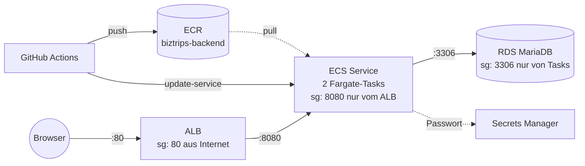
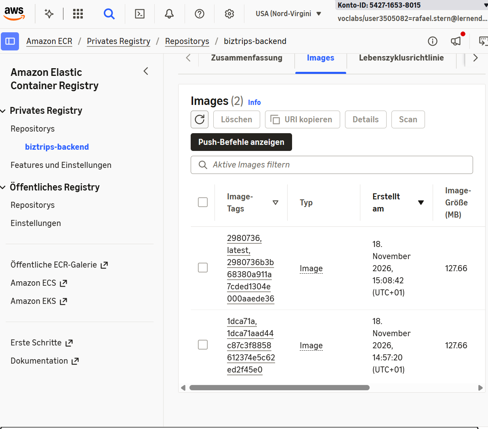
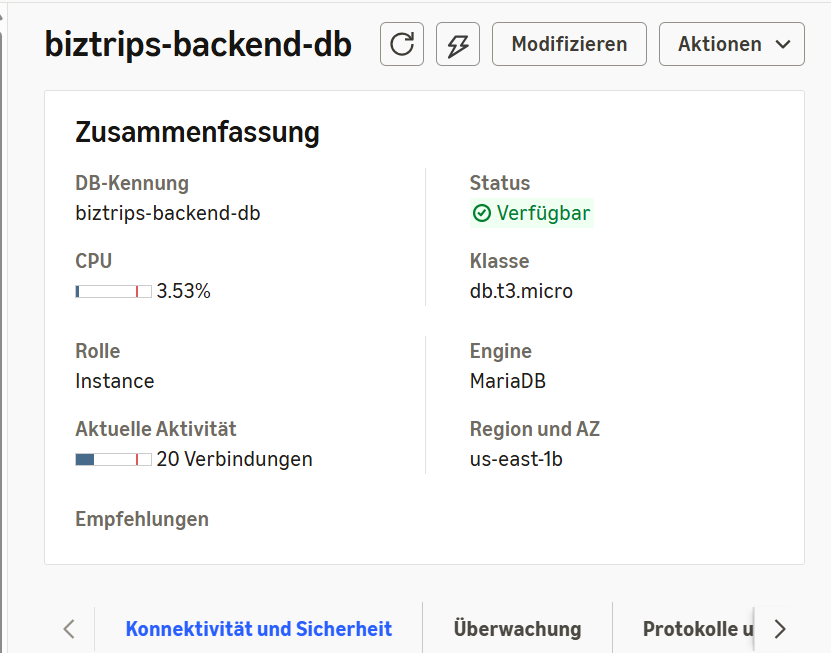
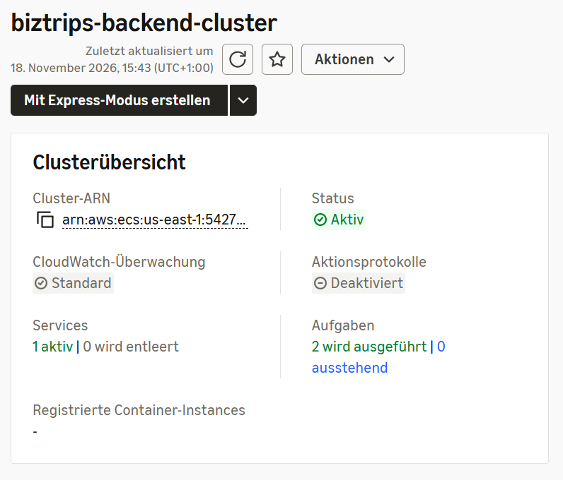
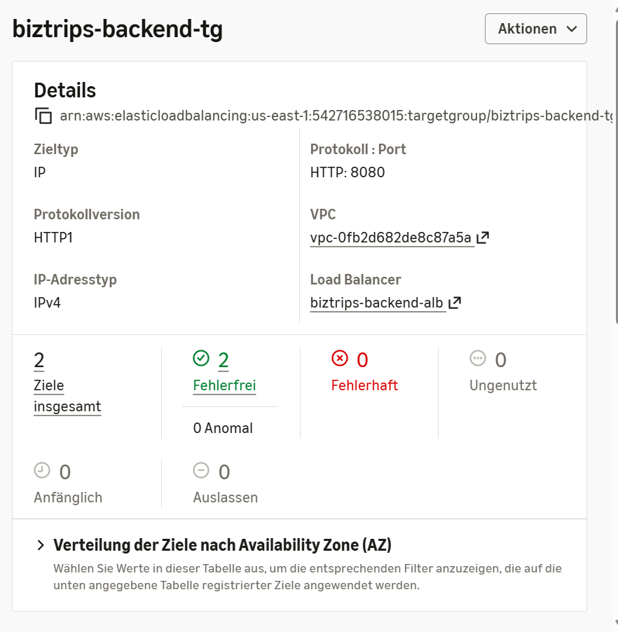
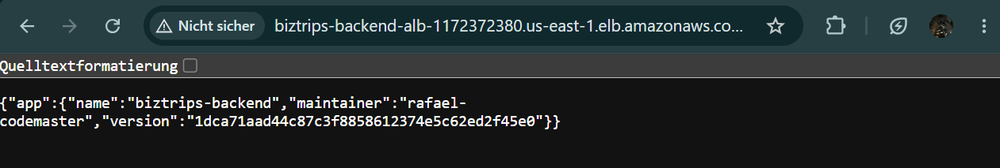
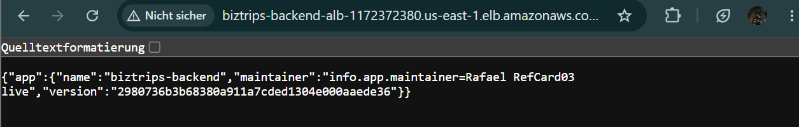

# EX-03 – Deploy auf AWS ECS (Fargate) mit RDS und GitHub Actions

**Ziel:** Jeder Push auf `main` baut ein Image, legt es in **ECR** ab und aktualisiert den **ECS-Fargate-Service** per Rolling Deployment. Die Datenbank läuft auf **RDS (MariaDB)**.

**Dateien:** [`task-definition.json`](../../task-definition.json), [`scripts/aws-ecs-setup.sh`](../../scripts/aws-ecs-setup.sh), [`scripts/aws-ecs-teardown.sh`](../../scripts/aws-ecs-teardown.sh), Job `deploy-ecs` in [`deploy.yml`](../../.github/workflows/deploy.yml)

## Architektur



## Vorgehen

1. **Learner Lab starten**, AWS-Konsole öffnen, **CloudShell** starten (Region `us-east-1`).
2. `scripts/aws-ecs-setup.sh` und `task-definition.json` in CloudShell hochladen (*Actions → Upload file*) und ausführen:
   ```bash
   bash aws-ecs-setup.sh
   ```
   Das Skript legt in dieser Reihenfolge an (Checkliste des Lehrers):
   1. ECR-Repository `biztrips-backend`
   2. *(OIDC entfällt im Learner Lab, siehe [README](README.md#kurzvergleich-learner-lab-keys-vs-oidc))*
   3. RDS `biztrips-backend-db` (MariaDB 10.11, nicht öffentlich) + zufälliges Passwort in Secrets Manager
   4. ECS-Cluster `biztrips-backend-cluster` + Log-Group `/ecs/biztrips-backend`
   5. Security Groups (ALB → Tasks → RDS, jeweils nur von der vorherigen Gruppe), Target Group (Typ `ip`, Health-Check `/actuator/health`), ALB + Listener :80
   6. Task-Definition registrieren (`LabRole` als Execution Role)
   7. ECS-Service (Fargate, Circuit Breaker mit automatischem Rollback, Health-Check-Grace-Period 120 s)

   Am Ende gibt es die Werte für `RDS_ENDPOINT`, `DB_SECRET_ARN`, `ALB_DNS` aus.
3. In GitHub die **Secrets** `AWS_ACCESS_KEY_ID`, `AWS_SECRET_ACCESS_KEY`, `AWS_SESSION_TOKEN` und die **Variables** aus Schritt 2 sowie `DEPLOY_ECS = true` setzen.
4. **Push auf `main`** → Job `deploy-ecs`:
   ECR-Login → Build + Push (`<sha>`, `latest`) → Platzhalter in der Task-Definition ersetzen → neues Image eintragen → Service auf 2 Tasks, Rolling Deployment, `wait-for-service-stability` → **Smoke-Test über den ALB** (neuer Commit in `/actuator/info`, Health `UP`, `/v1/trips` erreichbar).
5. **Änderung → Wirkung:** kleine sichtbare Änderung committen (z. B. `info.app.maintainer` in `application.properties`), pushen und `http://<ALB_DNS>/actuator/info` vorher/nachher vergleichen.
6. **Aufräumen** nach der Abgabe: `bash aws-ecs-teardown.sh`.

### Robustheit der Task-Definition

- `cpu 512 / memory 1024`, JVM nutzt max. 75 % (`-XX:MaxRAMPercentage=75`)
- Container-`healthCheck` (`wget /actuator/health`, `startPeriod 90`) **und** Target-Group-Health-Check
- DB-Passwort über `secrets` (Secrets Manager), URL/User über `environment`
- Logs nach CloudWatch (`awslogs`)

## Nachweise

**ECR** (Konto `5427-1653-8015`): pro Commit ein Image mit kurzem und vollem SHA-Tag, das neueste zusätzlich `latest`:



**RDS** `biztrips-backend-db` (MariaDB, db.t3.micro) verfügbar, mit aktiven Verbindungen der Tasks:



**ECS-Cluster**: 1 aktiver Service, 2 laufende Fargate-Tasks:



**Target Group** hinter dem ALB: beide Tasks fehlerfrei (Health-Check `/actuator/health`):



**Änderung → Wirkung** über `http://<ALB>/actuator/info`:

Vorher, Commit `1dca71a`:



Nach Änderung von `info.app.maintainer` und Push läuft automatisch Commit `2980736` (gleicher SHA wie das neue Image in ECR):



## Reflexion

1. **Was übernimmt ECS gegenüber dem SSH-Deploy?** Image ziehen, Container starten/stoppen, alte Tasks erst nach gesunden neuen abbauen (Rolling), abgestürzte Tasks ersetzen, Load-Balancer-Registrierung. Kein SSH, kein `systemctl` mehr.
2. **Warum ist OIDC sicherer als gespeicherte Keys?** Es wird nichts Langlebiges gespeichert, das gestohlen werden kann. Das Token gilt nur Minuten und nur für das konkrete Repo und den Branch. Der `EC2_SSH_KEY` dagegen gibt dauerhaft vollen Serverzugriff.
3. **Warum RDS statt DB-Container?** Fargate-Tasks sind zustandslos und haben keinen persistenten Disk (nur EFS mit Mehraufwand). Ein ersetzter Task würde die Daten verlieren. RDS übernimmt Storage, Backups und Patching, und beide Tasks teilen sich dieselbe DB.
4. **Warum Passwort unter `secrets`, URL unter `environment`?** URL und User sind keine Geheimnisse. Das Passwort wird erst beim Task-Start aus Secrets Manager injiziert und steht nie im Klartext in der Task-Definition oder im Repo.
5. **Was passiert bei `update-service`?** ECS startet neue Tasks mit der neuen Revision, wartet bis sie im ALB gesund sind und stoppt erst dann die alten (min. 50 % / max. 200 %). Es gibt keine Downtime, und bei Fehlern rollt der Circuit Breaker automatisch zurück. EX-01 hat dagegen einen Neustart mit Unterbruch.
6. **Warum Target-Group-Typ `ip`?** Fargate-Tasks haben keine EC2-Instanz-ID, sondern eine eigene ENI mit eigener IP (`awsvpc`). Die Target Group registriert deshalb IPs.
