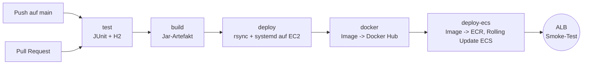

# RefCard 03/04 – Lösung (rafael-codemaster)

Spring-Boot-Backend „BusinessTrips“ mit MariaDB: automatisiert getestet, gebaut und auf **AWS EC2**, **Docker Hub** und **AWS ECS (Fargate) mit RDS** ausgeliefert, ergänzt um einen lokalen Foto-Storage (Vorstufe zu S3).

| Übung | Thema | Dokumentation |
|---|---|---|
| EX-01 | Deploy auf AWS EC2 mit GitHub Actions | [EX-01-EC2.md](EX-01-EC2.md) |
| EX-02 | Docker-Image bauen, taggen, auf Docker Hub veröffentlichen | [EX-02-DockerHub.md](EX-02-DockerHub.md) |
| EX-03 | Deploy auf AWS ECS (Fargate) + RDS via ECR | [EX-03-ECS.md](EX-03-ECS.md) |
| EX-04 | Lokaler Datei-Storage für Mitarbeiterfotos | [EX-04-Storage.md](EX-04-Storage.md) |

## Pipeline auf einen Blick

Datei: [`.github/workflows/deploy.yml`](../../.github/workflows/deploy.yml)

- **Pull Requests** durchlaufen nur `test` und `build`. Deploys und Image-Pushes passieren ausschliesslich auf `main` (Erweiterung EX-01).
- Jede Deploy-Stufe prüft sich selbst: Nach dem EC2- und ECS-Deploy fragt die Pipeline `/actuator/info` ab und ist erst grün, wenn **genau der gepushte Commit** antwortet und `/actuator/health` `UP` meldet.
- Fehlende Secrets/Variablen, eine nicht erreichbare EC2-Instanz oder eine abgelaufene Learner-Lab-Session führen zu einer klaren Fehlermeldung statt zu einem kryptischen Abbruch.
- Maven- und Docker-Layer-Caching (`cache: maven`, `cache-from: type=gha`) halten die Laufzeit kurz.

## Konfiguration in GitHub

**Secrets** (*Settings → Secrets and variables → Actions*):

| Name | Ebene | Inhalt |
|---|---|---|
| `EC2_HOST`, `EC2_USER`, `EC2_SSH_KEY` | Environment `production` | Public DNS, `ec2-user`/`ubuntu`, Inhalt von `labsuser.pem` |
| `DOCKERHUB_USERNAME`, `DOCKERHUB_TOKEN` | Repository | Docker-Hub-User und Access Token (nicht das Passwort) |
| `AWS_ACCESS_KEY_ID`, `AWS_SECRET_ACCESS_KEY`, `AWS_SESSION_TOKEN` | Repository | Learner Lab → *AWS Details → AWS CLI* |

**Variables** (keine Geheimnisse):

| Name | Beispiel | Zweck |
|---|---|---|
| `DEPLOY_EC2` / `PUSH_DOCKERHUB` / `DEPLOY_ECS` | `true` | Schaltet die jeweilige Stufe ein |
| `AWS_REGION` | `us-east-1` | Region des Learner Labs |
| `RDS_ENDPOINT` | `biztrips-backend-db.xxxx.us-east-1.rds.amazonaws.com` | DB-Host für die Task-Definition |
| `DB_SECRET_ARN` | `arn:aws:secretsmanager:us-east-1:…:secret:biztrips-backend-db-password-AbCdEf` | DB-Passwort (Secrets Manager) |
| `ALB_DNS` | `biztrips-backend-alb-123.us-east-1.elb.amazonaws.com` | Smoke-Test und Link im Workflow |

Im Repository stehen **keine Zugangsdaten**: Die Task-Definition enthält nur Platzhalter (`__AWS_ACCOUNT_ID__`, `__RDS_ENDPOINT__`, …), die die Pipeline zur Laufzeit ersetzt. Das DB-Passwort für ECS liegt in AWS Secrets Manager, jenes für EC2 nur in `/etc/businesstrips.env` (root-only) auf der Instanz.

## Learner Lab: Ablauf der Session und Erneuern der Secrets

Die AWS-Zugangsdaten des Learner Labs sind **temporär** (Session ca. 4 h). Nach jedem *Start Lab*:

1. Learner Lab → *AWS Details* → *AWS CLI: Show* öffnen.
2. Die drei Werte in GitHub unter *Settings → Secrets and variables → Actions* bei `AWS_ACCESS_KEY_ID`, `AWS_SECRET_ACCESS_KEY` und `AWS_SESSION_TOKEN` überschreiben (*Update secret*).
3. Hat sich die Public-DNS der EC2-Instanz durch Stop/Start geändert, zusätzlich `EC2_HOST` im Environment `production` anpassen.
4. Fehlgeschlagenen Run unter *Actions → Re-run failed jobs* neu starten.

Symptom einer abgelaufenen Session: `configure-aws-credentials` scheitert mit `ExpiredToken` bzw. `InvalidClientTokenId`; die Pipeline gibt dazu einen Hinweis aus.

## Kurzvergleich: Learner-Lab-Keys vs. OIDC

| | Temporäre Keys als Secrets (hier) | OIDC (Best Practice) |
|---|---|---|
| Gespeicherte Zugangsdaten | 3 Secrets in GitHub | keine – GitHub erhält pro Run ein kurzlebiges Token |
| Ablauf/Erneuerung | manuell nach jeder Lab-Session | automatisch, nichts zu pflegen |
| Einschränkung | volle Rechte der `LabRole` | Rolle per Trust Policy auf Repo + Branch (`repo:<user>/<repo>:ref:refs/heads/main`) beschränkt |
| Risiko bei Leak | Missbrauch bis Session-Ende | praktisch keines, Token gilt nur Minuten und nur für diesen Workflow |
| Learner Lab | funktioniert | nicht möglich (`iam:CreateRole`/OIDC-Provider gesperrt) |

## Versionierung

| Tag | Docker Hub | ECR | Bedeutung |
|---|---|---|---|
| `<voller SHA>` / `<kurzer SHA>` | ✓ | ✓ | unveränderlich, genau einem Commit zugeordnet (Rollback, Nachvollziehbarkeit) |
| `latest` | ✓ | ✓ | letzter erfolgreicher Build auf `main` |
| `prod01` | ✓ | – | was aktuell auf dem Produktionsserver (EC2) läuft |
| `1.2.0`, `1.2` | ✓ | ✓ | Release über Git-Tag `v1.2.0` (SemVer) |

ECS deployt immer den **SHA-Tag**, nie `latest`. So ist in der Task-Definition-Revision eindeutig sichtbar, welcher Commit läuft. Zusätzlich liefert `GET /actuator/info` die laufende Version (`info.app.version`).

Release erstellen: `git tag v1.0.0 && git push origin v1.0.0`.
